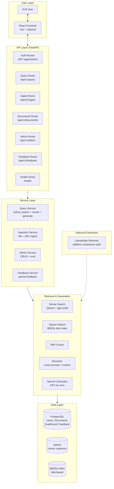

# ARCHITECTURE.md

## Enterprise RAG Knowledge Platform — System Architecture

### Overview

The Enterprise RAG Knowledge Platform is a role-based retrieval-augmented generation system. Users submit questions scoped to their department (HR, Engineering, Finance). The system retrieves relevant documents from a hybrid dense/sparse search index, reranks them, and generates answers with verifiable citations. Role-based access control (RBAC) is enforced at the Qdrant query layer, so restricted chunks never enter the LLM context.

### Mermaid Architecture Diagram

### Component Details

| Layer | Component | Technology | Responsibility |
|---|---|---|---|
| User Layer | React Frontend | React 18, Vite, Tailwind | Chat UI, admin dashboard, login |
| API Layer | FastAPI | FastAPI, Uvicorn | REST + SSE endpoints, CORS, rate limiting |
| Auth | JWT | python-jose, bcrypt | Access/refresh tokens in HttpOnly cookies |
| Service Layer | Query Service | Python | Hybrid retrieval, reranking, answer generation |
| Service Layer | Ingestion Service | Python | File/URL ingestion, Qdrant upsert, BM25 rebuild |
| Retrieval | Dense Search | Qdrant + sentence-transformers | Vector similarity with role filter |
| Retrieval | Sparse Search | BM25s | Keyword search with role filter |
| Retrieval | RRF Fusion | Python | Reciprocal Rank Fusion of dense + sparse |
| Retrieval | Reranker | Cross-encoder / Cohere | Relevance re-scoring |
| Generation | OpenAI Generator | GPT-4o-mini | Answer generation with bracketed citations |
| Data Layer | PostgreSQL | SQLAlchemy async + asyncpg | Users, documents, eval results, feedback |
| Data Layer | Qdrant | Qdrant vector store | Document chunk embeddings |
| Data Layer | BM25s | BM25s (disk index) | Keyword index |

### Data Flow

1. **Authentication**: User logs in → JWT access + refresh tokens set in HttpOnly cookies.
2. **Query**: User submits question → `run_query` → RBAC role filter → hybrid search (dense + sparse + RRF) → rerank → OpenAI generation → streaming SSE answer with citations.
3. **Ingestion**: Admin uploads file (PDF/TXT/MD/DOCX) or URL → text extraction → chunking → embedding → Qdrant upsert → Postgres Document record → BM25 rebuild.
4. **Evaluation**: Admin triggers RAGAS run → retrieval + generation per test question → RAGAS metrics → CSV + Postgres persistence.
5. **Feedback**: User rates an answer → persisted to `feedback` table in PostgreSQL.

### RBAC Enforcement

Roles: `hr`, `engineering`, `finance`, `admin`, `demo_admin`.

Each role can only retrieve documents tagged for its department. The JWT role claim is passed directly into the Qdrant `must` filter on `role_access`. No post-retrieval filtering occurs, so restricted chunks never reach the LLM.

### Extensions (Additive)

- **DOCX ingestion**: python-docx based `.docx` support added to the loader.
- **URL ingestion**: Requests + BeautifulSoup webpage text extraction; indexed like a document.
- **Structure-aware chunking**: Paragraph-aware chunking option added alongside fixed-word chunking.
- **Cohere Rerank**: Configurable Cohere reranker with cross-encoder fallback.
- **LlamaIndex**: Optional additive LlamaIndex retriever over the same Qdrant collection.
- **User feedback**: Feedback model + POST /feedback endpoint; persisted to PostgreSQL.
