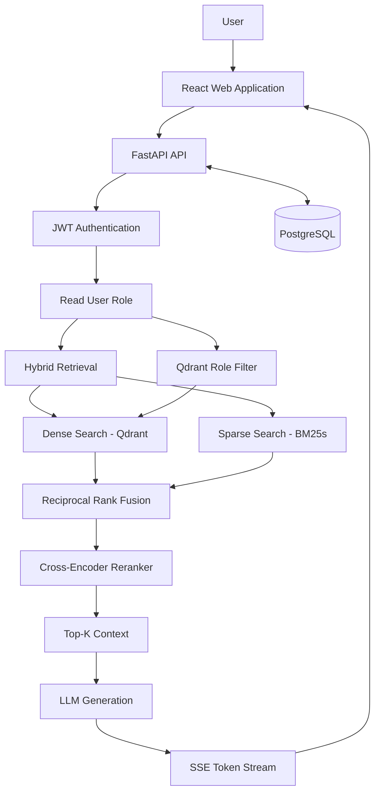
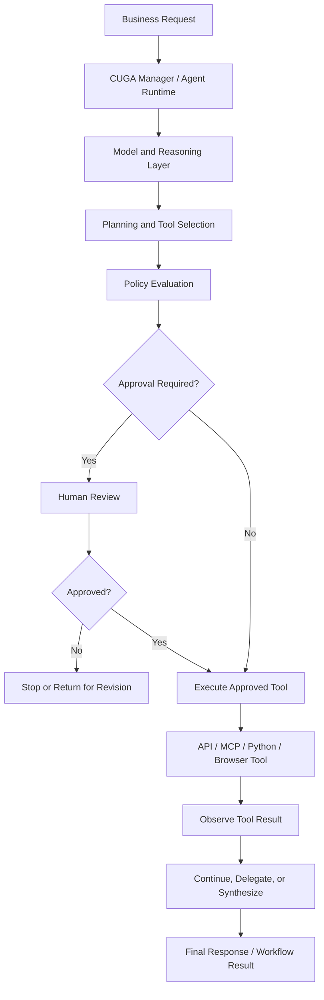

# Nexvia Projects

A collection of Generative AI systems focused on practical enterprise use cases, secure information retrieval, and agent-driven workflow automation.

This repository currently contains two independent projects. **GENAI-01** demonstrates a secure enterprise Retrieval-Augmented Generation (RAG) platform. **GENAI-02** contains CUGA, an enterprise agent harness for connecting models to tools, APIs, browser workflows, and controlled business processes.

> **Repository layout:** Each project has its own dependencies, configuration, runtime requirements, and documentation. Set up and run them independently.

---

## Table of Contents

- [Projects at a Glance](#projects-at-a-glance)
- [Repository Structure](#repository-structure)
- [GENAI-01 — Enterprise RAG with RBAC and Hybrid Search](#genai-01--enterprise-rag-with-rbac-and-hybrid-search)
  - [Overview](#genai-01-overview)
  - [Key Capabilities](#genai-01-key-capabilities)
  - [Architecture and Query Flow](#genai-01-architecture-and-query-flow)
  - [Technology Stack](#genai-01-technology-stack)
  - [Local Setup](#genai-01-local-setup)
  - [Evaluation](#genai-01-evaluation)
- [GENAI-02 — CUGA Enterprise Agent Harness](#genai-02--cuga-enterprise-agent-harness)
  - [Overview](#genai-02-overview)
  - [Key Capabilities](#genai-02-key-capabilities)
  - [Architecture and Execution Flow](#genai-02-architecture-and-execution-flow)
  - [Technology Stack](#genai-02-technology-stack)
  - [Local Setup](#genai-02-local-setup)
- [Configuration and Security](#configuration-and-security)
- [Development Guidelines](#development-guidelines)
- [Troubleshooting](#troubleshooting)
- [Roadmap](#roadmap)
- [Contributing](#contributing)
- [License and Attribution](#license-and-attribution)

---

## Projects at a Glance

| Project | Focus | Main Technologies | What it demonstrates |
|---|---|---|---|
| **GENAI-01** | Enterprise knowledge retrieval | FastAPI, React, PostgreSQL, Qdrant, BM25s, Sentence Transformers | Hybrid RAG, retrieval-time RBAC, reranking, streamed responses, document ingestion, and RAG evaluation |
| **GENAI-02** | Enterprise agent execution | Python, LangChain, LangGraph, FastAPI, MCP, Playwright, configurable model providers | Tool-enabled agents, execution policies, human approval, multi-agent workflows, and deployment control |

### How the projects complement each other

GENAI-01 focuses on **finding and answering questions from permission-scoped knowledge**. GENAI-02 focuses on **planning and carrying out tasks through configured tools and policies**. Together, they represent two important parts of enterprise GenAI engineering: trusted access to information and controlled execution of actions.

## Repository Structure

```text
nexvia_projects/
├── GENAI-01/
│   ├── backend/              # FastAPI service, RAG pipeline, ingestion and evaluation
│   ├── frontend/             # React + Vite user interface
│   ├── screenshots/          # Project screenshots
│   └── README.md             # Project-specific documentation
│
├── GENAI-02/
│   ├── src/                  # CUGA Python package and agent runtime
│   ├── docs/                 # Guides, examples and configuration documentation
│   ├── deployment/            # Deployment assets and guides
│   ├── events/               # Event-triggered workflow service assets
│   ├── pyproject.toml        # Python package and dependency configuration
│   ├── .env.example          # Model/provider configuration template
│   └── README.md             # Project-specific documentation
│
└── README.md                 # Repository overview and setup guide
```

The tree above highlights the main project areas; consult each project's own README for its full implementation details.

---

# GENAI-01 — Enterprise RAG with RBAC and Hybrid Search

## GENAI-01 Overview

GENAI-01 is an enterprise Retrieval-Augmented Generation platform built around a role-restricted knowledge base. It models three departments—**HR, Engineering, and Finance**—and ensures that users retrieve only the documents permitted for their department.

The system combines dense semantic retrieval with sparse keyword retrieval. It merges the ranked results, reranks the candidates with a cross-encoder, and sends the most relevant context to an LLM to generate an answer. Responses are streamed to the browser as they are generated.

A central design principle is that access control is enforced **inside the vector database query**, rather than retrieving unrestricted documents and filtering them later in application code. This prevents unauthorized document chunks from being included in the context passed to the language model.

## GENAI-01 Key Capabilities

### 1. Department-based role access control

- Supports HR, Engineering, and Finance department roles, alongside an administrator role.
- Uses JWT-based authentication.
- Associates indexed document chunks with allowed-role metadata.
- Applies a role filter to Qdrant queries before vector results are returned.
- Keeps authorization close to the retrieval boundary instead of relying on post-retrieval filtering.

### 2. Hybrid information retrieval

The retrieval pipeline combines two complementary approaches:

- **Dense retrieval:** Uses `BAAI/bge-small-en-v1.5` embeddings and vector similarity in Qdrant to find semantically related content.
- **Sparse retrieval:** Uses BM25s to find exact terms, names, identifiers, and keyword matches.
- **Reciprocal Rank Fusion (RRF):** Merges the dense and sparse ranked lists without requiring manually calibrated score weights.
- **Cross-encoder reranking:** Re-scores the merged candidates using `cross-encoder/ms-marco-MiniLM-L-6-v2` before generation.

This combination is designed to improve retrieval quality over relying on semantic similarity or keyword matching alone.

### 3. Document and webpage ingestion

The application supports ingestion from:

- PDF (`.pdf`)
- Plain text (`.txt`)
- Markdown (`.md`)
- Word documents (`.docx`)
- Webpage URLs through the URL-ingestion API

Ingested content is parsed, divided into chunks, embedded, and indexed in Qdrant. The sparse BM25 index is also updated so that both retrieval paths can use the new content.

### 4. Streaming answers

- The FastAPI backend streams answer tokens using Server-Sent Events (SSE).
- The React frontend progressively renders the response.
- Users can see the response as it is generated instead of waiting for the complete answer.

### 5. Feedback and observability

- Users can submit a rating from 1 to 5 and an optional comment for an answer.
- Feedback is persisted in PostgreSQL.
- LangSmith integration is available for tracing when configured.
- RAGAS is used to evaluate retrieval and answer quality.

### 6. Configurable reranking

The default reranker is the local cross-encoder. An optional Cohere reranker can be enabled using environment configuration. When Cohere is selected, the configured integration can fall back to the local cross-encoder if the external reranking call fails.

## GENAI-01 Architecture and Query Flow



**Conceptual request sequence:**

1. A user signs in and receives an authenticated session.
2. The API identifies the user's role from the authenticated identity.
3. The query is processed by dense and sparse retrieval paths.
4. The Qdrant search includes the user's permitted-role filter.
5. Reciprocal Rank Fusion combines the retrieved result lists.
6. A cross-encoder reranks the candidate passages.
7. The selected context is supplied to the configured LLM.
8. The answer is streamed to the frontend, and feedback can be saved for later review.

## GENAI-01 Technology Stack

| Layer | Technology | Responsibility |
|---|---|---|
| Backend API | FastAPI, Uvicorn, Pydantic v2 | API endpoints, validation, and streaming responses |
| Authentication | JWT, bcrypt, python-jose | Authentication and password hashing |
| Relational database | PostgreSQL, SQLAlchemy, asyncpg | Users, metadata, feedback, and evaluation records |
| Vector database | Qdrant | Dense vector storage and role-filtered retrieval |
| Sparse retrieval | BM25s | Keyword-based retrieval |
| Embeddings | BAAI/bge-small-en-v1.5 | Text embedding generation |
| Reranking | MiniLM cross-encoder; Cohere optional | Candidate relevance reranking |
| LLM | OpenAI GPT-4o-mini by default | Context-grounded answer generation |
| Evaluation | RAGAS | Faithfulness, relevancy, recall, and precision evaluation |
| Tracing | LangSmith | Optional request tracing |
| Frontend | React, Vite, Tailwind CSS | Chat interface and administrative screens |
| Infrastructure | Docker Compose | PostgreSQL and Qdrant service orchestration |

## GENAI-01 Local Setup

### Prerequisites

- Git
- Python 3.11
- Node.js 18 or later and npm
- Docker Engine and Docker Compose
- An OpenAI API key for the default generation provider

The embedding and reranking models may download model weights on first use. Ensure the machine has sufficient disk space, memory, and network access for initial setup.

### 1. Clone the repository

Run these commands from the directory where you want the project:

```bash
git clone https://github.com/Suryank7/nexvia_projects.git
cd nexvia_projects/GENAI-01
```

### 2. Configure the backend environment

```bash
cd backend
cp .env.example .env
```

Open `backend/.env` and configure at least the following values for local development:

```dotenv
POSTGRES_USER=rag_user
POSTGRES_PASSWORD=replace_with_a_strong_password
POSTGRES_DB=rag_db
POSTGRES_HOST=localhost
POSTGRES_PORT=5432

QDRANT_HOST=localhost
QDRANT_PORT=6333
QDRANT_COLLECTION=rag_documents

JWT_SECRET_KEY=replace_with_a_long_random_secret
JWT_ALGORITHM=HS256

OPENAI_API_KEY=your_openai_api_key
OPENAI_MODEL=gpt-4o-mini

APP_ENV=development
CORS_ORIGIN=http://localhost:5173
```

Keep the `.env` file private. Do not commit API keys, database passwords, or JWT secrets.

### 3. Start PostgreSQL and Qdrant

From the `GENAI-01/backend` directory:

```bash
docker compose up postgres qdrant -d
```

The backend Compose file defines PostgreSQL and Qdrant as persistent services. Their data is stored in Docker volumes.

To inspect service status:

```bash
docker compose ps
```

### 4. Install backend dependencies

Run from `GENAI-01/backend`:

```bash
python -m venv .venv
```

Activate the environment:

```bash
# Windows PowerShell
.venv\Scripts\Activate.ps1

# macOS / Linux
source .venv/bin/activate
```

Install dependencies:

```bash
python -m pip install --upgrade pip
pip install -r requirements.txt
```

### 5. Create users

The database schema is initialized by the backend on first startup. Start the backend once if required by the initialization flow, then use the project's user-creation script to add users.

Example accounts (replace the email addresses and passwords with your own values):

```bash
python scripts/create_user.py --email hr@example.com --password "use-a-strong-password" --role hr
python scripts/create_user.py --email engineering@example.com --password "use-a-strong-password" --role engineering
python scripts/create_user.py --email finance@example.com --password "use-a-strong-password" --role finance
python scripts/create_user.py --email admin@example.com --password "use-a-strong-password" --role admin
```

Use a different strong password for each account. Do not reuse the example password in a deployed environment.

### 6. Ingest department documents

Place the source files in the corresponding department data directories. Supported file formats include PDF, TXT, Markdown, and DOCX.

First, retrieve the administrator's database ID. With the default Compose service and database names, the command is:

```bash
docker exec -it rag_postgres psql -U rag_user -d rag_db -c "SELECT id FROM users WHERE email='admin@example.com';"
```

Use the returned UUID as the uploader ID:

```bash
python scripts/run_ingestion.py --department hr --dir data/hr/ --uploader-id <admin-uuid>
python scripts/run_ingestion.py --department engineering --dir data/engineering/ --uploader-id <admin-uuid>
python scripts/run_ingestion.py --department finance --dir data/finance/ --uploader-id <admin-uuid>
```

The ingestion pipeline chunks the source content, generates embeddings, writes vectors and metadata to Qdrant, and updates the BM25s index. Webpages can also be ingested through the URL-ingestion endpoint documented in the project README.

### 7. Start the backend API

From `GENAI-01/backend` with the virtual environment activated:

```bash
uvicorn app.main:app --host 0.0.0.0 --port 8000 --workers 2
```

The API is served at:

```text
http://localhost:8000
```

### 8. Start the frontend

Open a second terminal:

```bash
cd nexvia_projects/GENAI-01/frontend
npm install
npm run dev
```

Open the local Vite URL:

```text
http://localhost:5173
```

### 9. Stop local services

To stop the PostgreSQL and Qdrant containers:

```bash
cd nexvia_projects/GENAI-01/backend
docker compose down
```

To remove the containers **and their persisted data volumes**, use `docker compose down -v`. This permanently deletes local database and vector-store data, so use it only when a full reset is intended.

## GENAI-01 Evaluation

The project README reports a RAGAS evaluation over a fixed dataset of 50 questions:

- HR: 19 questions
- Engineering: 17 questions
- Finance: 14 questions

| Metric | Reported score | What it measures |
|---|---:|---|
| Faithfulness | **0.9926** | Whether generated claims are supported by retrieved context |
| Answer Relevancy | **0.8428** | Whether the answer addresses the user's question |
| Context Recall | **1.0000** | Whether relevant information was retrieved |
| Context Precision | **0.9423** | How relevant the retrieved context is |

These are the scores documented by the project for its stated evaluation dataset and configuration. They should not be interpreted as a guarantee of performance on a different corpus or workload. Evaluation outputs are stored in the backend evaluation results directory and can also be persisted for administrative review.

---

# GENAI-02 — CUGA Enterprise Agent Harness

## GENAI-02 Overview

GENAI-02 contains **CUGA**, a configurable enterprise agent harness designed to turn business requests into tool-mediated workflows. It connects language models to applications, APIs, documents, and browser-based interactions while providing policy controls over how tools are selected and executed.

The project is designed for environments where model choice, data boundaries, tool permissions, and human approval matter. It can be configured to use hosted model providers or compatible private inference endpoints. Its deployment documentation also covers private-cloud, Kubernetes, and air-gapped deployment patterns.

GENAI-02 is a separate Python project from GENAI-01. It has its own package configuration, environment file, dependency installation process, and runtime commands.

## GENAI-02 Key Capabilities

### 1. Tool and API integration

- Connects agents to tools and external services.
- Supports MCP (Model Context Protocol) integrations.
- Supports OpenAPI-based services and Python tools.
- Supports browser automation through Playwright and BrowserGym-related components.
- Allows workflows to combine API calls with browser interactions.

### 2. Policy-controlled execution

CUGA documents several policy types that can be configured through its UI or SDK:

| Policy | Purpose |
|---|---|
| **Intent Guard** | Blocks or responds to requests that match configured intent rules. |
| **Playbook** | Provides a standard procedure for a matching task. |
| **Tool Approval** | Pauses selected tool calls until a human approves them. |
| **Tool Guide** | Supplies domain-specific instructions and can be combined with ToolGuard enforcement. |
| **Output Formatter** | Structures the agent's output in a configured format. |

Tool-level guards can prevent a disallowed tool call from reaching the underlying tool. Approval gates can be used for operations that should not execute without human review.

### 3. Multi-agent orchestration

CUGA supports coordinating specialized agents through a supervisor pattern. Individual agents can be assigned distinct tools and instructions, while a supervisor routes or coordinates work across them.

The documented use cases include research, coding, review, knowledge assistance, and cross-application operations. The exact agent behavior depends on the configured models, tools, instructions, policies, and workflow.

### 4. Enterprise knowledge and documents

- Supports document-oriented knowledge assistance.
- Can combine shared reference material with documents provided in a conversation.
- Can generate answers with supporting citations when the configured knowledge workflow provides source references.
- Includes document-processing and retrieval components in its project dependencies.

### 5. Event-driven and scheduled workflows

The CUGA ecosystem includes a separately deployed events service for schedules, polling, and push-triggered workflows. Depending on configuration, it can run agents when an event occurs and deliver results through configured channels.

The events service is a separate deployment component; its availability should not be assumed from starting the core CUGA process alone.

### 6. Memory and reusable skills

With the relevant Evolve integration configured, CUGA can retrieve task guidance and user preferences and retain selected conversation trajectories. It also supports reusable agent skills defined through `SKILL.md` files.

Memory, retention controls, and related administration features require the corresponding services and configuration. They are not automatically enabled merely by installing the core package.

### 7. Model and deployment flexibility

- Supports configurable model-provider settings.
- Includes integrations for providers such as Groq, OpenAI-compatible endpoints, IBM watsonx, Ollama, and other configured backends.
- Can target a private OpenAI-compatible inference endpoint.
- Documents local/private-cloud, Kubernetes, and air-gapped deployment approaches.

## GENAI-02 Architecture and Execution Flow



**Conceptual execution sequence:**

1. A user submits a business task.
2. The agent runtime interprets the request using the configured model and instructions.
3. The agent identifies a tool or specialist agent needed for the task.
4. Configured policies are applied to the requested operation.
5. A human approval step is triggered when the policy requires one.
6. The approved tool or workflow is executed.
7. The agent observes the result and continues, delegates, or prepares the final response.
8. Execution history and optional observability data can be inspected when configured.

## GENAI-02 Technology Stack

| Area | Technologies / Components |
|---|---|
| Language and package management | Python, `uv`, `pyproject.toml` |
| Agent orchestration | LangChain, LangGraph, CUGA runtime |
| API runtime | FastAPI, Uvicorn |
| Tool integration | MCP, FastMCP, OpenAPI, Python tools |
| Browser automation | Playwright, BrowserGym components |
| Model providers | Groq, OpenAI-compatible endpoints, IBM watsonx, Ollama, LiteLLM integrations |
| Document processing | Docling integrations, OCR fallback, text processing |
| Data and checkpoints | SQLite, PostgreSQL, pgvector and related checkpoint components |
| Observability | Langfuse and configurable tracing components |
| Configuration | Dynaconf, environment variables, TOML settings |
| Deployment | Docker, Kubernetes/Helm assets, private and air-gapped deployment guidance |

The available integrations depend on the enabled configuration, optional dependencies, and external services. Installing the package does not automatically provision every provider, connector, or supporting service.

## GENAI-02 Local Setup

### Prerequisites

- Git
- Python 3.12 recommended for the documented quick-start path
- `uv` package manager
- A supported LLM provider account and API key, or an accessible compatible inference endpoint

The package metadata currently declares Python support as `>=3.10, <3.15`; the project's quick-start documentation uses Python 3.12.

Install `uv` using the official instructions: <https://docs.astral.sh/uv/getting-started/installation/>.

### 1. Move into GENAI-02

If you have not cloned the repository yet:

```bash
git clone https://github.com/Suryank7/nexvia_projects.git
cd nexvia_projects/GENAI-02
```

If the repository is already available locally, simply change into its `GENAI-02` directory.

### 2. Create the environment and install dependencies

From `GENAI-02`:

```bash
uv sync --python 3.12
```

`uv` creates and manages the project environment based on the package configuration and lockfile.

### 3. Configure the model provider

Create a local environment file:

```bash
# macOS / Linux
cp .env.example .env

# Windows PowerShell
Copy-Item .env.example .env
```

The supplied example configuration selects Groq by default. Configure the key and model you intend to use:

```dotenv
GROQ_API_KEY=your_groq_api_key
MODEL_NAME=openai/gpt-oss-120b
AGENT_SETTING_CONFIG=settings.groq.toml
```

Alternatively, configure an OpenAI model by setting the corresponding values in `.env` and selecting the OpenAI settings file:

```dotenv
OPENAI_API_KEY=your_openai_api_key
MODEL_NAME=gpt-4o
AGENT_SETTING_CONFIG=settings.openai.toml
```

Use one provider configuration at a time. Refer to `GENAI-02/.env.example` and the configuration guide in `GENAI-02/docs/` for additional providers and advanced settings. Never commit the populated `.env` file.

### 4. Start the manager interface

From `GENAI-02`:

```bash
uv run cuga start manager --crm
```

Open the local URL printed in the terminal and navigate to `/manage` to access the manager interface. The CRM tools and other integrations may require additional configuration before they can be used.

### 5. Explore other documented start modes

The project's own documentation includes additional examples, such as:

```bash
# CRM demonstration in read-only mode
uv run cuga start demo_crm --read-only

# Knowledge demonstration
uv run cuga start demo_knowledge

# Supervisor demonstration
uv run cuga start demo_supervisor
```

Use the mode that matches the example you are exploring. Some examples require their own data, credentials, model configuration, or supporting services.

### 6. Configure a private inference endpoint (optional)

For an OpenAI-compatible private endpoint, configure the provider settings with the endpoint URL, key, and model identifier exposed by your inference server. For example:

```dotenv
AGENT_SETTING_CONFIG=settings.openai.toml
OPENAI_BASE_URL=http://your-inference-service:8000/v1
OPENAI_API_KEY=your_endpoint_key
MODEL_NAME=your_served_model_name
```

The endpoint must be reachable from the environment running CUGA. Provider-specific configuration and model capabilities may affect which features are available.

### 7. Explore deployment and advanced features

For advanced configuration, consult the local documentation included with the project:

- `GENAI-02/docs/` — configuration, examples, and guides
- `GENAI-02/deployment/` — deployment and Kubernetes-related material
- `GENAI-02/events/` — event service deployment and connector configuration

Official project resources:

- CUGA documentation: <https://docs.cuga.dev>
- CUGA upstream repository: <https://github.com/cuga-project/cuga-agent>

---

## Configuration and Security

Both projects interact with model providers, databases, or external tools. Treat configuration and authorization as part of the application design—not as optional deployment cleanup.

### Secrets management

- Keep `.env` files local and out of version control.
- Use strong, unique passwords and secrets.
- Rotate API keys if they are accidentally exposed.
- Prefer deployment secrets or a managed secret store for shared environments.
- Never place credentials in screenshots, logs, sample datasets, or issue reports.

### Access control

- In GENAI-01, verify department-role metadata during ingestion and test that users cannot retrieve documents belonging to other departments.
- In GENAI-02, configure tool permissions, guards, and approval policies before enabling actions that change external systems.
- Use read-only access for demonstrations whenever write access is not required.
- Review tool behavior and external side effects before connecting production accounts.

### Production readiness

Before deploying either project for real users, review authentication configuration, CORS rules, database backups, logging, network exposure, rate limits, secret rotation, error handling, and monitoring. Development defaults and sample configurations are not a production security assessment.

---

## Development Guidelines

1. **Keep projects isolated.** Install dependencies from the relevant project directory; do not combine their Python environments.
2. **Keep configuration examples safe.** Update `.env.example` with variable names and placeholders only—never real credentials.
3. **Document reproducible commands.** Include the working directory for commands that depend on project paths.
4. **Test authorization boundaries.** For GENAI-01, test cross-department access explicitly. For GENAI-02, test blocked actions and approval-required workflows.
5. **Measure before optimizing.** Use RAGAS and representative data for retrieval changes; use workflow tests and execution traces for agent changes.
6. **Review external integrations.** Model APIs, MCP servers, browser tools, and connected business systems can introduce costs and side effects.
7. **Keep project-specific documentation current.** Add new setup steps, environment variables, and known limitations to the relevant subproject README.

## Troubleshooting

| Problem | Checks and possible resolution |
|---|---|
| GENAI-01 cannot connect to PostgreSQL | Confirm the PostgreSQL container is running and that `POSTGRES_HOST`, port, database, username, and password match the local setup. Use `docker compose ps` to inspect service status. |
| GENAI-01 cannot connect to Qdrant | Confirm the Qdrant container is running and that `QDRANT_HOST=localhost` is used when the API runs directly on the host. Container-to-container networking uses the Compose service name instead. |
| GENAI-01 frontend cannot reach the API | Check that the backend is listening on port `8000`, the frontend origin matches `CORS_ORIGIN`, and the frontend API configuration points to the correct backend URL. |
| GENAI-01 returns no relevant results | Confirm documents were ingested into the correct department, the user has the expected role, and both the Qdrant collection and BM25s index were populated. |
| GENAI-01 model requests fail | Verify the provider API key, model name, provider quota, network connectivity, and timeout configuration. |
| GENAI-02 fails during dependency installation | Confirm the Python version, `uv` installation, and project directory. Re-run `uv sync --python 3.12` from `GENAI-02`. |
| GENAI-02 cannot call the model | Check that the selected `AGENT_SETTING_CONFIG` matches the provider, required credentials are present, and the model identifier is supported by the endpoint. |
| GENAI-02 tool or browser actions fail | Verify the relevant connector configuration, tool permissions, external service availability, and any browser/runtime setup described in the project documentation. |
| GENAI-02 events or memory features are unavailable | Check the separate events or Evolve service setup. These capabilities require additional services and configuration. |

For project-specific errors, consult the README and documentation inside the relevant project directory before changing dependency versions or configuration.

## Roadmap

The following are potential areas for continued improvement, not claims that these features are already implemented:

- Add a root-level development guide with shared contribution and release conventions.
- Add automated linting, type checks, and CI workflows for each project.
- Expand GENAI-01 evaluation with larger, versioned datasets and regression tests for department isolation.
- Add automated security tests for retrieval filters, authentication, and tool-policy enforcement.
- Document repeatable local demo data and seed scripts.
- Add deployment-specific examples for staging and production environments.
- Track operational metrics such as request latency, retrieval latency, token usage, cost, and failure rates.

## Contributing

Contributions, fixes, and suggestions are welcome.

1. Fork the repository.
2. Create a feature branch:

   ```bash
   git checkout -b feature/your-change
   ```

3. Make your changes within the relevant project directory.
4. Run the available tests or validation steps for that project.
5. Update the relevant README and configuration examples if behavior or setup changes.
6. Commit your work with a clear message and open a pull request describing the change, its motivation, and how it was tested.

For larger changes, open an issue first to discuss the proposed implementation and its impact on the existing project structure.

## License and Attribution

The project-specific documentation currently declares:

- **GENAI-01:** MIT License.
- **GENAI-02 / CUGA:** Apache License 2.0, with the upstream project identified as [`cuga-project/cuga-agent`](https://github.com/cuga-project/cuga-agent).

These project-level license declarations should be reviewed in the corresponding directories before reuse or redistribution. They do not, by themselves, establish a single umbrella license for every file in the top-level repository. Retain applicable copyright notices, license files, and third-party attributions when distributing code.

---

<p align="center">
  Built around secure retrieval, controlled execution, and practical Generative AI engineering.
</p>
